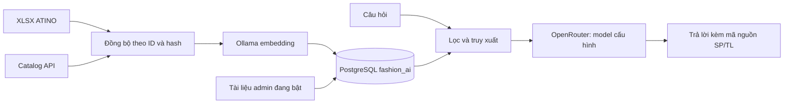

# Đánh giá AI RAG FashionHub

Ngày kiểm tra: 15/11/2026. Phạm vi: mã nguồn, unit test và chạy thực tế trên Docker. Provider tạo câu trả lời là **OpenRouter**; embedding dùng `qwen3-embedding:0.6b` qua Ollama. Không có chứng nhận chung tên “chuẩn quốc tế RAG”; cần đánh giá riêng truy xuất, tính bám nguồn, an toàn và vận hành.

## Luồng hiện tại

## Đã khắc phục

| Vấn đề | Hiện trạng |
| --- | --- |
| Tự đổi model | OpenRouter chỉ gọi `AI_CHAT_MODEL`, thử lại tối đa một lần khi lỗi tạm thời. Không tự chuyển sang `openrouter/free`. Lỗi provider trả 503. |
| Câu trả lời như viết sẵn | Câu hỏi có sản phẩm/tài liệu phù hợp gửi đến OpenRouter. Quy tắc phản hồi chính xác của admin là luồng riêng với `answerOrigin=RULE`; không có kết quả là `NO_RESULTS`. |
| Chính sách cứng trong prompt | Prompt lấy chính sách từ tài liệu admin đang bật. Quy tắc phản hồi chính xác không lẫn vào truy xuất ngữ nghĩa. |
| Nguồn khó đối chiếu | Ngữ cảnh, API và giao diện dùng `[SP1]` cho sản phẩm, `[TL1]` cho tài liệu. |
| Gợi ý sản phẩm không liên quan | Truy xuất có ngưỡng điểm tối thiểu; ràng buộc giá/size/màu có thể trả rỗng. |

## Bằng chứng chạy thực tế

- AI image build thành công; **12 unit test Python qua**; frontend build thành công.
- Chỉ mục có 280 sản phẩm Catalog và 280 mục workbook; Ollama embedding hoạt động.
- Bộ đánh giá `ai-service/eval/retrieval_cases.json` có 10 ca: 5 tên chính xác, 4 câu tự nhiên có ràng buộc, 1 câu không có kết quả. **10/10 qua**, exact recall@5 = 1,0; p50 2,48 giây, tối đa 4,17 giây trên máy kiểm tra. Bộ nhỏ chưa đại diện lưu lượng thật.
- Câu “Áo phông nào mặc mát dưới 200k?” gọi OpenRouter thật, trả 3 nguồn và `answerOrigin=MODEL` sau khoảng 12,5 giây. Câu “Áo xanh neon dưới 1000đ size 4XL” trả `NO_RESULTS`, không bịa sản phẩm.

## Giới hạn còn lại

1. Vector ở `DOUBLE PRECISION[]`, chấm điểm trong Python sau khi đọc bảng. Cần benchmark và pgvector/ANN khi tập dữ liệu tăng mạnh.
2. Bộ 10 ca mới kiểm tra retrieval; chưa đo độ đúng từng mệnh đề, p95, lỗi provider hay prompt injection trên tập lớn. Mã `[SP/TL]` cho biết nguồn đưa vào prompt, **không tự chứng minh** mọi phát biểu của model.
3. Prompt coi tài liệu truy xuất là dữ liệu không đáng tin, nhưng prompt đơn lẻ không loại bỏ hết prompt injection.
4. Trạng thái job đồng bộ nằm trong RAM. Provider/model của mỗi lượt chỉ có ở phản hồi trực tiếp, chưa lưu trong lịch sử DB. `/health` chưa kiểm tra toàn bộ dependency.
5. Nếu Catalog xóa sản phẩm nhưng workbook vẫn chứa nó, bản workbook có thể xuất hiện lại. Cần xử lý cả hai nguồn hoặc có danh sách loại trừ.

Tiêu chí mở rộng: [Microsoft RAG evaluators](https://learn.microsoft.com/en-us/azure/foundry/concepts/evaluation-evaluators/rag-evaluators), [OWASP LLM01](https://genai.owasp.org/llmrisk/llm01-prompt-injection/), [pgvector](https://github.com/pgvector/pgvector). Xem [hướng dẫn dựng và kiểm chứng](ai-rag-build-guide.md).
