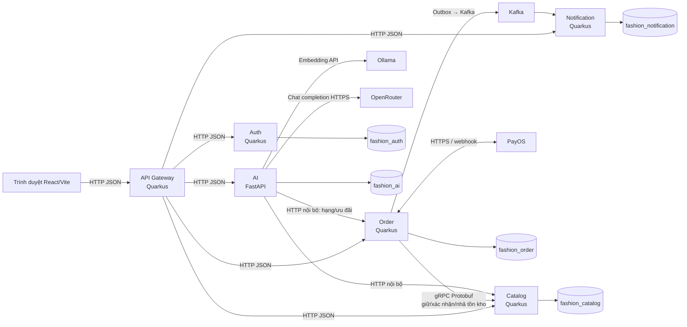

# Mô tả hệ thống FashionHub

*Bản mô tả theo mã nguồn và môi trường Docker đang chạy ngày 16/11/2026. Có thể sử dụng làm nội dung báo cáo; nên thay số liệu khảo sát khi chốt bản nộp.*

## 1. Bài toán và phạm vi

FashionHub là hệ thống bán thời trang trực tuyến kết hợp trợ lý tư vấn sản phẩm. Khách hàng xem danh mục, tìm và lọc sản phẩm, chọn biến thể màu/cỡ, đặt hàng, thanh toán, theo dõi đơn và nhận thông báo. Quản trị viên quản lý sản phẩm, ảnh, tồn kho, khuyến mãi, đơn hàng, banner, đánh giá, tri thức của trợ lý và chương trình thành viên. Trợ lý AI trả lời dựa trên dữ liệu sản phẩm đang bán và tài liệu tư vấn, đồng thời giữ ngữ cảnh hội thoại.

Mục tiêu thiết kế là tách các miền nghiệp vụ thành service có dữ liệu riêng, tránh để giao diện trực tiếp thao tác cơ sở dữ liệu, và để giá, tồn kho, trạng thái đơn có nguồn dữ liệu xác định. Hệ thống hiện triển khai cho mục đích học tập và thử nghiệm trên Docker Compose.

## 2. Người dùng và chức năng

| Vai trò | Chức năng chính |
|---|---|
| Khách chưa đăng nhập | Xem trang chủ, banner, cây danh mục, tìm/lọc và xem chi tiết sản phẩm; xem giá, biến thể, ảnh, đánh giá; hỏi trợ lý AI. |
| Khách đã đăng nhập | Các chức năng trên; quản lý hồ sơ, địa chỉ tỉnh/thành phố và xã/phường, đổi mật khẩu, giỏ hàng, yêu thích; đặt hàng COD hoặc PayOS, theo dõi/hủy đơn theo điều kiện; nhận thông báo; đánh giá sản phẩm đã mua; xem điểm, hạng và ưu đãi; tiếp tục hội thoại AI. |
| Quản trị viên | Quản lý danh mục nhiều cấp, sản phẩm/biến thể/ảnh, tồn kho, giảm giá, banner; cập nhật trạng thái đơn; theo dõi đánh giá, thông báo và thống kê; cấu hình tích điểm, hạng và ưu đãi; thêm/sửa/ẩn/xóa/tái lập chỉ mục tài liệu tri thức, cập nhật tri thức sản phẩm, xem hội thoại. |

Các ràng buộc nghiệp vụ quan trọng: giá áp dụng dựa trên biến thể và khuyến mãi đang hiệu lực; tồn kho được giữ khi tạo đơn và xác nhận/giải phóng theo luồng đơn; đánh giá gắn với giao dịch mua hợp lệ; lịch sử trạng thái đơn và lịch sử thanh toán được lưu riêng; quyền quản trị được kiểm tra tại API chứ không chỉ ẩn nút trên giao diện.

## 3. Kiến trúc triển khai

Frontend viết bằng React, TypeScript và Vite. Năm backend nghiệp vụ gồm bốn service Java Quarkus (Auth, Catalog, Order, Notification), một AI service Python FastAPI; API Gateway cũng dùng Quarkus. Ở môi trường phát triển, frontend truy cập tại `localhost:5173`; bản frontend Docker ở `localhost:3000`. Gateway tại cổng 8080. Mỗi service sở hữu một database PostgreSQL riêng trong cùng instance PostgreSQL; Kafka truyền sự kiện đơn hàng sang Notification. Không có MongoDB trong luồng vận hành hiện tại. Service Java dùng JDBC và Flyway; AI dùng PostgreSQL và migration Python.

| Service | Trách nhiệm | Dữ liệu sở hữu |
|---|---|---|
| Auth | Đăng ký, đăng nhập, JWT/refresh token, đổi/đặt lại mật khẩu, hồ sơ, địa chỉ, vai trò. | `fashion_auth` |
| Catalog | Danh mục, sản phẩm, biến thể, ảnh, tồn kho, giảm giá, đánh giá, yêu thích, banner. | `fashion_catalog` |
| Order | Giỏ hàng, tạo và xử lý đơn, COD/PayOS, lịch sử, outbox, điểm và hạng thành viên. | `fashion_order` |
| Notification | Tiêu thụ sự kiện, tạo thông báo trong ứng dụng, ghi nhận sự kiện đã xử lý. | `fashion_notification` |
| AI | Nhập/index sản phẩm, tài liệu tư vấn, truy xuất ngữ nghĩa, hội thoại, gọi mô hình. | `fashion_ai` |

Các giao tiếp giữa trình duyệt và gateway, giữa gateway với service, AI với Catalog/Order là HTTP/JSON. Riêng nghiệp vụ giữ, xác nhận và nhả tồn kho **Order → Catalog dùng gRPC/Protobuf**. Sự kiện đơn mới/trạng thái thay đổi được Order ghi vào outbox rồi đưa qua Kafka cho Notification. Tham chiếu giữa các database sử dụng ID và API, không join hoặc khóa ngoại xuyên database.

## 4. Quy trình nghiệp vụ chính

### 4.1. Khám phá và quản lý sản phẩm

Catalog lưu danh mục bằng `parent_id`, cho phép phân cấp nhiều tầng. Một sản phẩm thuộc một danh mục, có nhiều biến thể theo màu/cỡ; sản phẩm và biến thể có bảng ảnh riêng. Mức giá đang bán được xác định từ giá biến thể và đợt khuyến mãi có hiệu lực. Giao diện sử dụng ảnh chính để hiển thị nhanh, có thể xem các ảnh khác khi vào chi tiết. Quản trị viên điều chỉnh tồn kho và theo dõi biến động, tạo giảm giá có điều kiện thời gian, cập nhật banner trang chủ. Dữ liệu Catalog cũng là nguồn chính cho trợ lý AI khi tư vấn sản phẩm đang bán.

### 4.2. Đặt hàng, thanh toán và thông báo

Khách chọn biến thể và số lượng vào giỏ, chọn địa chỉ giao hàng, sau đó đặt COD hoặc PayOS. Order kiểm tra và yêu cầu Catalog giữ hàng qua gRPC; đơn và dòng hàng được lưu với ảnh chụp thông tin giao dịch tại thời điểm đặt. Với PayOS, Order tạo lần thanh toán, chuyển khách đến trang thanh toán và tiếp nhận webhook để cập nhật trạng thái thanh toán. Trạng thái đơn và thanh toán có lịch sử riêng để phục vụ đối soát. Khi đơn thay đổi, sự kiện outbox được phát qua Kafka; Notification tạo thông báo cho khách hoặc quản trị viên. Các sự kiện đã xử lý được ghi dấu để giảm tác động của việc nhận lặp.

Tích hợp PayOS thực tế phụ thuộc bộ khóa cấu hình và webhook có thể truy cập từ bên ngoài. Trong cấu hình mặc định của Compose, khóa PayOS là `disabled`; báo cáo không nên diễn đạt rằng một giao dịch PayOS thật đã được kiểm chứng chỉ từ việc service khởi chạy. Hoàn tiền tự động qua PayOS chưa phải chức năng hoàn chỉnh của bản hiện tại.

### 4.3. Đánh giá và thành viên

Khách đã mua sản phẩm có thể gửi đánh giá theo điều kiện đơn hợp lệ; đánh giá và ảnh thuộc Catalog. Order quản lý điểm và hạng. Điểm chỉ phát sinh cho đơn đáp ứng điều kiện hoàn tất/thanh toán, có liên kết với đơn để tránh cộng trùng. Cấu hình hạng và ưu đãi có thể điều chỉnh; trợ lý AI nhận hạng, điểm và ưu đãi hiện hành qua API nội bộ để cá nhân hóa nội dung, không tự bịa ưu đãi. Tại lúc xuất schema, bảng đánh giá, phát sinh điểm và ưu đãi theo hạng chưa có dữ liệu thực tế, nên chỉ có thể khẳng định đã có thiết kế và luồng chức năng, chưa có số liệu vận hành để đánh giá hiệu quả.

### 4.4. Trợ lý tư vấn

Tài liệu tư vấn được quản trị viên thêm/sửa/ẩn và lập chỉ mục theo đoạn. Dữ liệu sản phẩm được đồng bộ từ Catalog; workbook ATINO chỉ dùng để nhập dữ liệu ban đầu, không được lập chỉ mục riêng trong lúc vận hành. Khi người dùng hỏi về sản phẩm, hệ thống lọc và xếp hạng ứng viên rồi lấy giá/tồn kho trực tiếp từ Catalog trước khi gửi ngữ cảnh tới mô hình OpenRouter. Hội thoại và nguồn tham khảo được lưu để hỗ trợ câu hỏi tiếp theo. Một số tình huống có nhánh xử lý xác định, ví dụ quy tắc trả lời do quản trị viên cấu hình, đếm số sản phẩm từ Catalog, hoặc tìm cửa hàng dựa trên vị trí. Phần quy trình AI được trình bày chi tiết tại [quy-trinh-xay-dung-rag.md](quy-trinh-xay-dung-rag.md).

## 5. Thiết kế dữ liệu và bảo mật

Sơ đồ dữ liệu ở mức miền: Auth giữ tài khoản và địa chỉ; Catalog giữ cây danh mục, sản phẩm, biến thể, ảnh, khuyến mãi, tồn kho và đánh giá; Order giữ giỏ, đơn, thanh toán, outbox và thành viên; Notification giữ mẫu/thông báo/sự kiện; AI giữ chỉ mục, tri thức và hội thoại. Danh sách đầy đủ 41 bảng và các tệp SQL schema nằm tại [docs/database/README.md](../database/README.md).

Mật khẩu được băm bằng BCrypt; API sử dụng JWT và refresh token. Kiểm soát quyền người dùng/quản trị thực hiện ở service. Kết nối nội bộ dùng khóa API cho các endpoint nội bộ. Dữ liệu giao dịch thuộc service sở hữu, và AI chỉ nhận phần dữ liệu cần thiết cho tư vấn. Đây là mô tả cơ chế có trong mã nguồn, không phải kết luận kiểm thử xâm nhập hoặc chứng nhận an toàn. Bản Compose hiện dùng chung tài khoản PostgreSQL cho cả năm database, nên có thể cải thiện bằng tài khoản DB riêng và quyền tối thiểu khi triển khai thực tế.

## 6. Giới hạn và hướng phát triển

Hệ thống chạy trên một bộ Docker Compose, một PostgreSQL instance và một Kafka broker; chưa chứng minh được khả năng chịu lỗi hoặc mở rộng theo cụm. Embedding được lưu dưới dạng mảng số và tính cosine trong ứng dụng Python, phù hợp quy mô hiện tại nhưng cần cơ chế chỉ mục vector/ANN và đo hiệu năng khi số sản phẩm lớn. Danh sách cửa hàng/vị trí hiện là dữ liệu cấu hình mẫu; tính năng tìm gần nhất dùng khoảng cách đường chim bay. Chưa có kết quả đo định lượng chính thức cho chất lượng câu trả lời RAG, độ trễ hoặc tải đồng thời. Những mục này cần ghi là hướng đánh giá/cải tiến trong báo cáo thay vì kết quả đã đạt.
