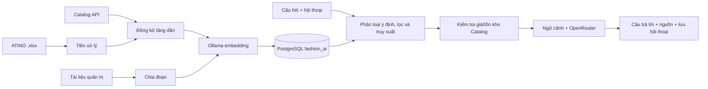

# Quy trình xây dựng trợ lý RAG cho FashionHub

*Mô tả theo triển khai hiện tại ngày 16/11/2026. RAG (Retrieval-Augmented Generation) là quy trình truy xuất dữ liệu liên quan trước khi mô hình sinh câu trả lời.*

## 1. Mục tiêu và luồng xử lý

Trợ lý phục vụ tìm sản phẩm theo loại, màu, size, giá và nhu cầu sử dụng; giải đáp chính sách; hỗ trợ chọn size; cung cấp thông tin thành viên; duy trì hội thoại nhiều lượt. Giá, tồn kho và khuyến mãi phải lấy từ Catalog hiện hành. Mô hình sinh câu trả lời qua **OpenRouter** (`AI_PROVIDER=openrouter`); embedding của tài liệu và câu hỏi được tạo bằng **Ollama** với `qwen3-embedding:0.6b` theo cấu hình mặc định. Tên mô hình chat lấy từ `AI_CHAT_MODEL`, mặc định trong Compose là `nvidia/nemotron-3-ultra-550b-a55b:free`; có thể thay bằng mô hình OpenRouter khác. Nếu OpenRouter hoặc embedding không khả dụng, hệ thống báo lỗi phù hợp, không giả lập câu trả lời từ mô hình.

## 2. Thu thập và làm sạch dữ liệu

Nguồn ban đầu là `ai-service/atino_products.xlsx`. Bộ đọc Excel kiểm tra các cột bắt buộc: `Product ID`, `Tên sản phẩm`, `Danh mục`, `Giá bán (VNĐ)`. Các bước tiền xử lý gồm chuẩn hóa Unicode và khoảng trắng; loại dòng thiếu ID số, tên, danh mục hoặc giá hợp lệ; bỏ ID trùng; chuẩn hóa giá về số nguyên đồng; tách và loại trùng màu/size; kiểm tra slug và tên file ảnh; rút thông tin chất liệu khi có thể; bỏ phần mô tả chỉ lặp chính sách vận chuyển/đổi trả để không biến chính sách thành đặc tính riêng của sản phẩm. Báo cáo chất lượng ghi số dòng, số hợp lệ, số loại và số ID trùng. Bảng tính được nhập vào Catalog để trở thành dữ liệu sản phẩm giao dịch; chỉ mục workbook được giữ riêng để theo dõi nguồn.

Sản phẩm do khách có thể mua được lấy qua API nội bộ phân trang của Catalog. Bản ghi đưa vào chỉ mục có ID, tên, danh mục, giá, giá gốc, màu, size, mô tả, ảnh, đường dẫn và tình trạng còn hàng. Tài liệu chính sách/hướng dẫn do quản trị viên quản lý nằm trong `knowledge_documents`, tách với sản phẩm. Một số chính sách mặc định được khởi tạo để hệ thống có tri thức cơ bản.

## 3. Tạo và cập nhật chỉ mục

Mỗi sản phẩm được tạo thành một đoạn văn ngắn gồm tên, danh mục, giá, biến thể và mô tả. Hệ thống tính SHA-256 từ dữ liệu đã chuẩn hóa và nội dung; chỉ tạo embedding lại nếu hash hoặc định danh mô hình embedding đổi. Sản phẩm mới được thêm, sản phẩm thay đổi được cập nhật và ID không còn trong nguồn được xóa khỏi chỉ mục nguồn đó. Công việc này chạy định kỳ (mặc định **90 giây**), có nút cập nhật tri thức sản phẩm cho quản trị viên và có thể được Catalog yêu cầu chạy lại khi dữ liệu sản phẩm thay đổi. Chỉ mục `workbook` và `catalog` có khóa nguồn riêng; lúc tư vấn hàng đang bán chỉ truy vấn `source='catalog'`.

Tài liệu tư vấn được chuẩn hóa khoảng trắng rồi chia thành đoạn **800 ký tự, chồng lấn 120 ký tự**; mỗi đoạn có embedding, ID tài liệu, vị trí đoạn và trạng thái lập chỉ mục. Khi tài liệu đổi, các đoạn cũ được thay bằng các đoạn mới sau khi tạo embedding thành công. Quản trị viên có thể thêm, sửa, ẩn/hiện, xóa và lập chỉ mục lại; hệ thống ghi trạng thái `INDEXED`/`FAILED` cùng lỗi gần nhất. PostgreSQL lưu vector trong cột `DOUBLE PRECISION[]`; bản hiện tại chưa dùng `pgvector` hoặc chỉ mục ANN.

## 4. Xử lý câu hỏi và truy xuất

Khi nhận câu hỏi, AI service lưu tin nhắn, lấy tối đa **8 tin gần nhất** của hội thoại, xác định nhóm yêu cầu như sản phẩm, chính sách, giao hàng, size, số lượng sản phẩm hoặc cửa hàng gần người dùng. Ngữ cảnh đưa tới mô hình gồm tối đa **6 tin trước**. Câu hỏi nhiều lượt về size được viết lại theo lịch sử để tiếp tục truy xuất bảng size; người dùng có thể bổ sung chiều cao/cân nặng ở lượt sau.

Với sản phẩm, hệ thống chỉ xét bản ghi Catalog còn hàng, lọc trước theo size, màu, loại sản phẩm và điều kiện mùa/ngân sách nếu câu hỏi có nêu. Embedding câu hỏi được so cosine với embedding sản phẩm, kết hợp khớp từ khóa theo trọng số **0,85 ngữ nghĩa + 0,15 từ khóa** và một số điều chỉnh theo mùa. Ứng viên đạt điểm tối thiểu khoảng **0,18** được xếp hạng; tối đa 5 sản phẩm được đưa vào ngữ cảnh. Nếu Ollama tạm thời không tạo được embedding câu hỏi ở nhánh sản phẩm, việc xếp hạng có thể dựa vào từ khóa; không đồng nghĩa hệ thống đã có khả năng truy xuất ngữ nghĩa đầy đủ trong lần đó.

Với tri thức, các đoạn của tài liệu đang hoạt động được so cosine với câu hỏi, ngưỡng **0,2**, kết hợp các chính sách khớp theo chủ đề. Kết quả được khử trùng lặp theo tài liệu, tối đa 3–4 nguồn tùy nhánh trả lời. Đây là truy xuất tuyến tính trong ứng dụng, chưa có bộ reranker học máy hoặc bộ đánh giá chất lượng tự động.

Trước khi tư vấn sản phẩm, AI gọi lại API chi tiết Catalog để xác nhận sản phẩm còn hoạt động, biến thể còn hàng, **giá và khuyến mãi hiện tại**. Giá trong chỉ mục chỉ dùng để tìm kiếm sơ bộ. Nếu không xác nhận được giá từ Catalog, API trả lỗi thay vì trình bày giá cũ như giá hiện hành. Khi hỏi tổng số sản phẩm, hệ thống lấy `totalElements` trực tiếp từ Catalog; nếu Catalog tạm ngắt, câu trả lời phải phân biệt số lượng của chỉ mục đồng bộ gần nhất với số lượng trực tiếp.

## 5. Tạo câu trả lời và lưu vết

Prompt gửi OpenRouter bao gồm quy tắc trả lời, tối đa bốn nguồn tài liệu đánh dấu `[TL1]...`, tối đa năm sản phẩm đánh dấu `[SP1]...`, câu hỏi hiện tại và lịch sử gần đây. Thông tin sản phẩm trong prompt có giá vừa kiểm tra, giá gốc, khuyến mãi, màu, size, chất liệu và đường dẫn khi có. Mô hình sinh ngôn ngữ tự nhiên dựa trên ngữ cảnh này. AI service lưu câu trả lời, nguồn tham khảo và các sản phẩm được gợi ý để giao diện hiển thị thẻ sản phẩm/đường dẫn. Phản hồi API có `answerOrigin`, `provider` và `requestedModel`, giúp phân biệt nhánh mô hình với nhánh quy tắc.

Một số câu trả lời **cố ý không gọi mô hình**: quy tắc trả lời chính xác do quản trị viên tạo (`RULE`), tra cứu cửa hàng theo dữ liệu tọa độ (`STORE_LOOKUP`), yêu cầu cung cấp vị trí (`LOCATION_NEEDED`) và trường hợp không tìm thấy dữ liệu (`NO_RESULTS`). Điều này cần được mô tả rõ để không nhầm toàn bộ phản hồi là đầu ra OpenRouter. Với câu hỏi gần cửa hàng, giao diện có thể xin quyền vị trí; nếu khách từ chối, trợ lý hỏi tỉnh/thành hoặc khu vực. Tọa độ cửa hàng hiện là dữ liệu mẫu và khoảng cách là đường chim bay.

Nếu người dùng đăng nhập, AI gọi API nội bộ Order để lấy hạng, điểm và ưu đãi thực tế, rồi đưa vào ngữ cảnh cá nhân hóa. Khi API này không khả dụng, trợ lý tiếp tục ở mức chung và không tự tạo ưu đãi. Hội thoại được gắn với tài khoản khi đăng nhập; API kiểm tra quyền sở hữu hội thoại trước khi đọc/ghi.

## 6. Vận hành, kiểm thử và giới hạn

Quản trị viên theo dõi số tài liệu Catalog/workbook, trạng thái đồng bộ, lỗi gần nhất và trạng thái tài liệu tri thức. Những kiểm thử cần đưa vào báo cáo gồm: số sản phẩm Catalog bằng số bản ghi chỉ mục Catalog sau đồng bộ; thêm/sửa/xóa sản phẩm làm thay đổi chỉ mục; giá/khuyến mãi cập nhật được dùng khi trả lời; câu hỏi nhiều lượt về size; câu hỏi ngoài phạm vi; nguồn tham khảo hợp lệ; phân quyền tài liệu và hội thoại; lỗi Ollama/OpenRouter/Catalog được báo rõ. Các tệp kiểm thử hiện có nằm tại `ai-service/tests/` và `ai-service/eval/`. Cần chạy và ghi lại kết quả cụ thể khi chốt báo cáo; tài liệu này không khẳng định một tỷ lệ chính xác RAG chưa được đo.

Giới hạn hiện tại là tính cosine bằng cách duyệt vector trong Python, chi phí tăng theo số tài liệu; truy xuất phụ thuộc embedding Ollama; chưa có đánh giá thực nghiệm với bộ câu hỏi được gán nhãn đầy đủ, chưa có reranker riêng, và dữ liệu cửa hàng mẫu chưa đại diện mạng lưới thực tế. Hướng mở rộng là chuyển sang chỉ mục vector có ANN, thêm quy trình đo Recall@k và độ đúng của câu trả lời/nguồn, giám sát độ trễ và lỗi theo từng bước, cùng cơ chế versioning tri thức để truy vết thay đổi.

## 7. Các thành phần triển khai để đối chiếu

| Bước | Mã nguồn hoặc dữ liệu |
|---|---|
| Đọc và chuẩn hóa workbook | `ai-service/app/ingestion/workbook.py`, `ai-service/atino_products.xlsx` |
| Đồng bộ sản phẩm và truy xuất | `ai-service/app/services/products.py` |
| Tài liệu tư vấn và chia đoạn | `ai-service/app/services/knowledge.py` |
| Ollama embedding, OpenRouter chat | `ai-service/app/services/model.py` |
| Hội thoại, định tuyến yêu cầu, API | `ai-service/app/main.py`, `ai-service/app/services/conversation.py` |
| Dữ liệu và migration AI | `ai-service/migrations/`, [schema fashion_ai](../database/schema-export/fashion_ai.sql) |
| Cấu hình chạy | `infrastructure/docker/compose.yaml`, `ai-service/app/core/settings.py` |
