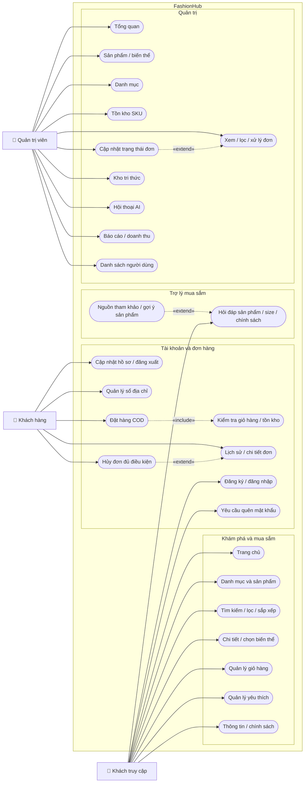

# Biểu đồ use case tổng quát - FashionHub

Biểu đồ dưới đây mô tả **chức năng thể hiện trong frontend hiện tại**. Các service Spring Boot và AI trong repo mới là khung khởi chạy; các use case nghiệp vụ đang chạy bằng dữ liệu mock hoặc lưu trong trình duyệt. Bản UML chuẩn có actor, ranh giới hệ thống và quan hệ `include`/`extend` nằm ở [use-case-overview.puml](use-case-overview.puml).

## Actor và phạm vi

| Actor | Quyền truy cập trong giao diện |
| --- | --- |
| Khách truy cập | Xem sản phẩm và chính sách, tìm kiếm, dùng giỏ hàng/yêu thích cục bộ, hỏi chatbot, đăng ký/đăng nhập. |
| Khách hàng | Kế thừa quyền khách truy cập; thêm hồ sơ, địa chỉ, đặt hàng COD, xem và hủy đơn đủ điều kiện. |
| Quản trị viên | Kế thừa quyền khách hàng; truy cập các trang `/admin` để quản lý dữ liệu demo. |

## Danh mục use case chi tiết

| Nhóm | Use case con hoặc thao tác được bao quát |
| --- | --- |
| Sản phẩm | Xem trang chủ, danh mục, danh sách; tìm kiếm, lọc theo giá/size/màu/danh mục, sắp xếp, xem chi tiết và sản phẩm liên quan, chọn size/màu. |
| Giỏ hàng | Thêm sản phẩm/biến thể, chọn hoặc bỏ chọn món, đổi số lượng, xóa món, xem tạm tính và phí vận chuyển. |
| Yêu thích | Thêm/bỏ sản phẩm yêu thích và xem danh sách. |
| Tài khoản | Đăng ký, đăng nhập, đăng xuất, xem và sửa họ tên/số điện thoại; gửi yêu cầu quên mật khẩu ở mức giao diện demo. |
| Địa chỉ | Thêm, sửa, xóa và đặt địa chỉ mặc định. |
| Đặt hàng | Xem lại giỏ và địa chỉ nhận, kiểm tra tồn kho trong luồng mock, chọn COD, tạo đơn và xem kết quả. |
| Đơn của tôi | Xem danh sách, lọc theo trạng thái, xem chi tiết/lịch sử xử lý, hủy đơn khi trạng thái cho phép. |
| Trợ lý | Hỏi đáp sản phẩm, chọn size, giao hàng, đổi trả; xem nguồn tham khảo và sản phẩm được gợi ý nếu câu trả lời có. |
| Sản phẩm và danh mục admin | Xem/tìm/lọc, tạo, sửa, xóa sản phẩm; quản lý biến thể; thêm, sửa, xóa danh mục khi hợp lệ. |
| Tồn kho và đơn admin | Tìm SKU, điều chỉnh tồn; tìm/lọc đơn, xem chi tiết, cập nhật trạng thái theo luồng hợp lệ. |
| AI và báo cáo admin | Thêm/sửa/xóa tài liệu tri thức, xem hội thoại phát sinh trên trình duyệt, xem thống kê đơn/doanh thu, xem danh sách tài khoản mẫu. |

## Giới hạn hiện tại

- Thanh toán chỉ có **COD** trong luồng giao diện. Không có cổng thanh toán ngoài.
- Quên mật khẩu chỉ hiện thông báo demo; đổi mật khẩu, email thông báo và AI/RAG thực chưa tích hợp.
- Địa chỉ, giỏ hàng và yêu thích lưu trên trình duyệt; danh sách người dùng và hội thoại AI ở trang admin là dữ liệu demo.
- API nghiệp vụ của backend Spring Boot chưa được triển khai. `notification-service` là khung kỹ thuật, chưa có use case gửi thông báo để đưa vào biểu đồ.

Nguồn đối chiếu: `frontend/src/app/App.tsx`, các trang trong `frontend/src/features/`, `frontend/src/services/`, `frontend/API_CONTRACT.md` và `frontend/README.md`.
